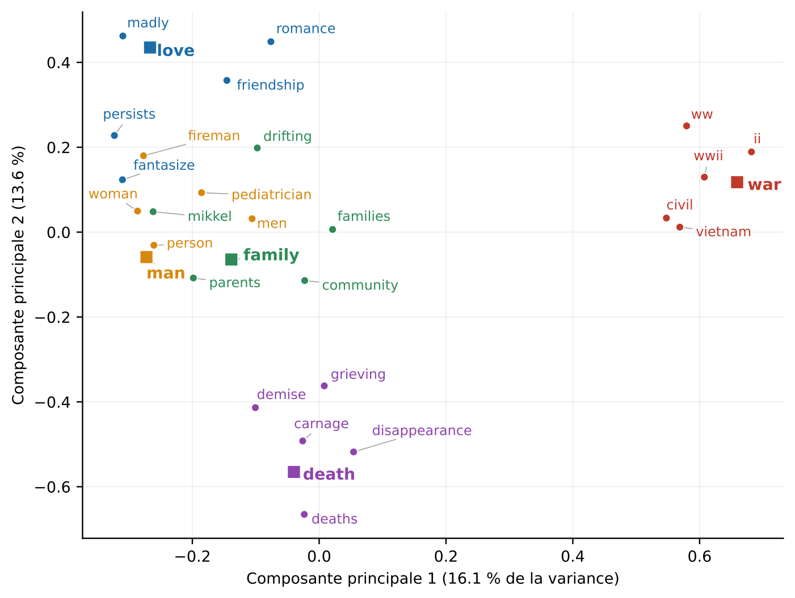
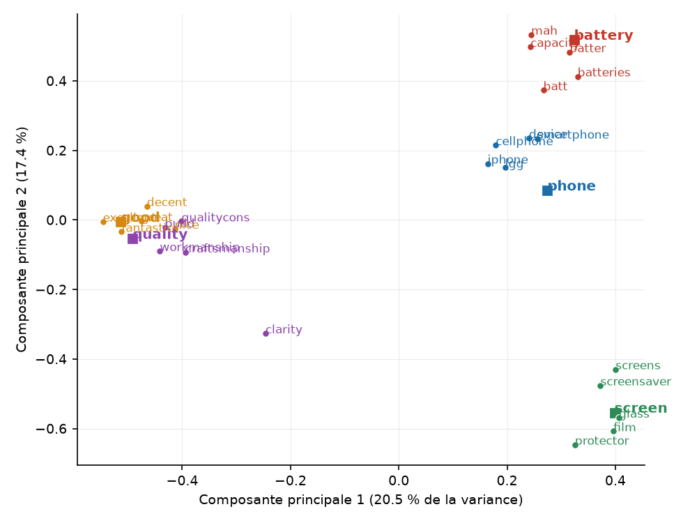

# Word2Vec with Gensim: movie summaries vs. Amazon phone reviews

Training and evaluating **Word2Vec** word embeddings on two very different English corpora, using Python and **Gensim**.
University project (M2 BIDABI, 2026).

| Corpus | Source | Texts | Tokens | Vocabulary |
| --- | --- | ---: | ---: | ---: |
| Movie summaries | [The Movies Dataset (Kaggle)](https://www.kaggle.com/rounakbanik/the-movies-dataset) | 44,493 | 2.4 M | 22,573 words |
| Phone reviews | [Amazon Cell Phones & Accessories (Stanford SNAP)](http://snap.stanford.edu/data/amazon/productGraph/categoryFiles/reviews_Cell_Phones_and_Accessories_5.json.gz) | 194,329 | 17.3 M | 20,853 words |

## Key findings

- **Each model learns what its corpus talks about.** The movie model groups words by theme (*war* → *civil*, *wwii*, *vietnam*); the review model groups product vocabulary (*battery* → *capacity*, *mah*, *batteries*).
- **Similar does not mean synonym.** Words used in the same contexts end up close (*man* / *woman*: 0.68; *good* / *decent*: 0.84).
- **Data cleaning shows up directly in the results.** Typos and abbreviations left in the reviews become nearest neighbours (*battery* → *batter* 0.88, *batt* 0.75).
- **A higher analogy score does not mean a better model.** The review model scores 29.6% vs. 9.5%, but mostly thanks to comparatives (*good → better*), which are everywhere in reviews. The movie model does better on family relations (51.0% vs. 40.9%).

## Method

1. **Preprocessing**: lowercasing, regex tokenization (letters only, contractions kept), one-letter tokens removed except *i*. For reviews, a short list of frequent typos is corrected (*quaility* → *quality*) and some joined words are split (*phoneit* → *phone it*).
2. **Training**: Word2Vec Skip-gram, same settings for both corpora so they can be compared.

   | Parameter | Value |
   | --- | --- |
   | `sg` | 1 (Skip-gram) |
   | `vector_size` | 100 |
   | `window` | 5 |
   | `min_count` | 5 |
   | `epochs` | 10 |

3. **Evaluation**: nearest neighbours (cosine similarity), word-pair similarity, the Google analogy test set shipped with Gensim (19,544 questions), and a 2D PCA projection.

## Results

### Nearest neighbours

| Movies | Top 3 neighbours | Reviews | Top 3 neighbours |
| --- | --- | --- | --- |
| war | ii (0.83), civil (0.69), wwii (0.67) | battery | batter (0.88), batt (0.75), capacity (0.75) |
| death | deaths (0.69), disappearance (0.63), demise (0.60) | screen | glass (0.78), film (0.73), screens (0.72) |
| man | woman (0.68), person (0.59), fireman (0.57) | good | decent (0.84), great (0.78), fantastic (0.71) |

Full lists and comments: [the report](Report/Word2Vec_report.pdf) (sections 8 and 9) and [`Results/reviews_results_corrected.txt`](Results/reviews_results_corrected.txt).

### Analogy test

| | Movies | Reviews |
| --- | ---: | ---: |
| Questions tested (out of 19,544) | 8,703 | 7,392 |
| Correct answers | 824 | 2,187 |
| **Overall accuracy** | **9.5%** | **29.6%** |
| Family (*boy : girl :: brother : ?*) | 51.0% | 40.9% |
| Comparatives (*good : better :: bad : ?*) | 6.6% | 67.9% |

A question is skipped when one of its words is missing from the vocabulary, so the two models are not tested on the same questions.

### PCA projection

| Movie summaries | Amazon reviews |
| --- | --- |
|  |  |

## Project structure

```
├── main.py                  # Movies: preprocessing, training, evaluation
├── reviews_word2vec.py      # Amazon reviews: preprocessing, training, evaluation
├── Test_analogies.py        # Google analogy test on both models
├── generer_figures.py       # PCA figures
├── Results/                 # Text results (models are not versioned)
├── Report/figures/          # Figures
├── requirements.txt
└── Data/                    # Datasets, not versioned (see below)
```

## How to run

```bash
python -m venv .venv
.venv\Scripts\activate          # Windows  (macOS/Linux: source .venv/bin/activate)
pip install -r requirements.txt
```

Download the data into a `Data/` folder:
- `movies_metadata.csv` from [Kaggle](https://www.kaggle.com/rounakbanik/the-movies-dataset)
- the [Amazon reviews file](http://snap.stanford.edu/data/amazon/productGraph/categoryFiles/reviews_Cell_Phones_and_Accessories_5.json.gz), renamed `reviews.json.gz`

Then, from the project folder:

```bash
python main.py
python reviews_word2vec.py
python Test_analogies.py
python generer_figures.py
```

Training takes about 30 s for the movies and 3 min for the reviews on a laptop. Because training runs on several threads, results can vary slightly from one run to another. The figures in this README are those of the report.

## Limitations

- Small, specialised corpora: the analogy test was built for much larger, general-purpose models.
- One vector per word: *film* (screen protector vs. movie) mixes its meanings.
- Removing digits loses information (*World War II* → *ii*, *LG G2* → *lgg*).
- Rare words, such as first names seen only a few times, get unreliable vectors.

## Author

Salma Alaoui Mrani
